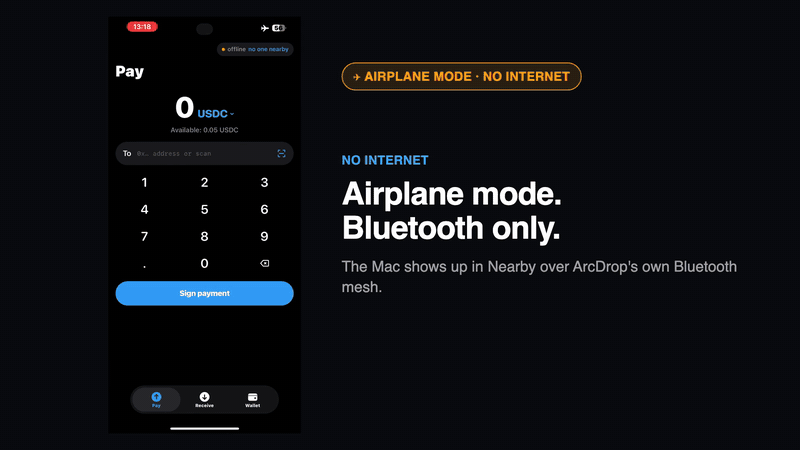
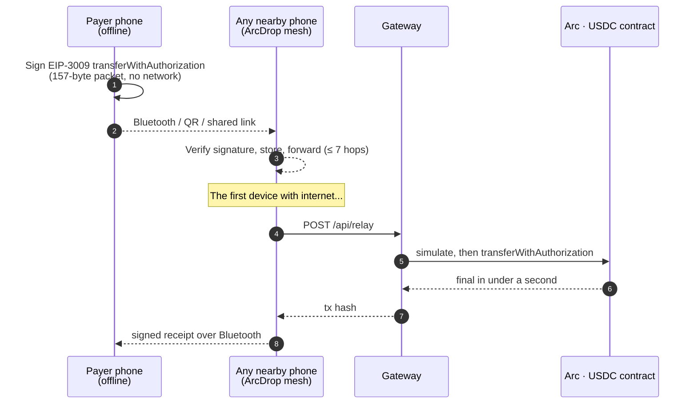
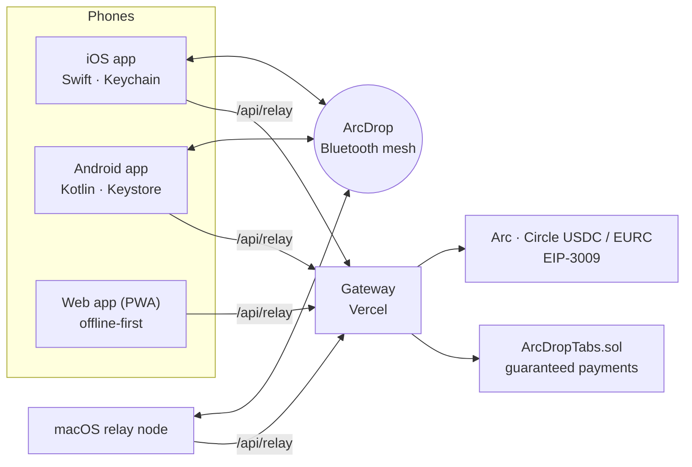

<div align="center">

# ArcDrop

**Pay in USDC with no internet.**
Sign in airplane mode, hand the payment over by Bluetooth, QR or a shared link,
and it settles on [Arc](https://arc.io) the moment any phone nearby gets a signal.

[**▶ Watch the 40 s demo on YouTube**](https://youtu.be/JI5XYOO8iiQ) ·
[Web app](https://arcdrop-pink.vercel.app) ·
[Android APK](https://github.com/SKorhacker/ArcDrop/releases/latest) ·
[Mainnet transaction](https://explorer.arc.io/tx/0x87be8dade5ca7214b86798291c07664fd4ddb420618b24d09223d3dab35af832)

<a href="https://youtu.be/JI5XYOO8iiQ"></a>

<sub>Real devices, Arc mainnet: the iPhone stays in airplane mode while the Mac, reached over ArcDrop's Bluetooth mesh, settles the payment in 1.01 s.</sub>

</div>

---

## Why

Payments stop working exactly when you need them most: festivals, metros, planes, blackouts, places where the network is down or too expensive. Cash still works there. ArcDrop makes digital dollars work there too, without trusting the people or phones that carry the payment.

## How it works



1. **A payment is a signed USDC authorization** ([EIP-3009](https://eips.ethereum.org/EIPS/eip-3009)) on Arc's native USDC. Signing needs only the key on the phone, so it works in airplane mode.
2. **Anyone can carry it, nobody can steal it.** The recipient, amount and expiry are inside the signature. A courier can deliver it, not redirect it, and its random nonce settles at most once, however many paths it takes.
3. **The first device online settles it.** Gas on Arc is paid in USDC, so relaying costs a known fraction of a cent, and Arc's deterministic sub-second finality turns "pending" into "final" the instant a node reconnects.

## What's inside



| Part | What it does |
|---|---|
| [`core/`](core) | Packet formats, offline sign/verify, on-chain proof of payment (viem). Shared by every app and the gateway. |
| [`web/`](web) | The app itself: pay, receive, nearby, requests, tabs. Bundled offline inside the iOS and Android apps. |
| [`ios-app/`](ios-app), [`android-app/`](android-app) | Native hosts: Bluetooth mesh, secure key storage, share sheet, payment links that open the app. |
| [`mesh/`](mesh) | The Bluetooth LE mesh (Swift) and a macOS relay node. The Android mesh is a byte-compatible Kotlin port. |
| [`relayer/`](relayer), [`api/`](api) | The gateway: verifies, simulates, settles and pays gas, with abuse limits. |
| [`contracts/`](contracts) | `ArcDropTabs.sol`: lock funds for one person so offline payments to them are guaranteed. |

More detail: [Architecture](docs/ARCHITECTURE.md) · [Protocol](docs/PROTOCOL.md) · [Security](docs/SECURITY.md)

## Features

- **Nearby, like AirDrop.** ArcDrop phones around you show up with their name and distance; tap one, type an amount, done.
- **Offline receipts.** The recipient's phone signs the payment and sends it back over Bluetooth: the payer sees "received" with no network.
- **USDC and EURC.** Both Circle stablecoins, both with EIP-3009 on Arc.
- **Requests and merchant mode.** Show a QR with the amount (optionally split between friends); the payer scans and signs.
- **Guaranteed payments ("tabs").** Lock an amount for one person while online; every offline payment to them is then backed by funds that can only go to them.
- **Honest status.** "Pending" until Arc says otherwise; "settled" only with on-chain proof that exactly this amount reached exactly this recipient.

## Verified on real devices

| Test | Result |
|---|---|
| iPhone in airplane mode → Bluetooth → Mac → **Arc mainnet** | settled in **1.01 s** · [tx](https://explorer.arc.io/tx/0x87be8dade5ca7214b86798291c07664fd4ddb420618b24d09223d3dab35af832) |
| Payment signed offline, settled through the public gateway, **Arc mainnet** | 1.1 s · [tx](https://explorer.arc.io/tx/0x128ef4aa79487a1ab032959a5d34cf83f3a158be06279cec5f09f869f75ebf1f) |
| iPhone in airplane mode → Bluetooth → Mac → Arc testnet | 0.93 s · [tx](https://explorer.testnet.arc.io/tx/0x01b3f891389190ca822cc6538e0509e5455fdbef18d08410934af873af7862a8) |
| Mac → iPhone over Bluetooth, with the offline receipt coming back | 0.80 s · [tx](https://explorer.testnet.arc.io/tx/0xc7b4cf8fc2e53fd203e1f3a9f563b7ce5b174744d05922b293fd486dae17979e) |
| Android (tester's phone) receives a payment link, app opens, settles | 0.82 s · [tx](https://explorer.testnet.arc.io/tx/0x43db1665b738ad112fa9db4a0d4cd6b7735a3a247a8b8ef47475f47e3e563429) |

Not yet tested side by side: Bluetooth between an Android phone and an iPhone (same wire format, checked byte for byte).

## Try it

- **Android:** install `ArcDrop.apk` from the [latest release](https://github.com/SKorhacker/ArcDrop/releases/latest) (allow "unknown apps"). Update in place to keep your wallet; uninstalling erases it.
- **Web:** open [arcdrop-pink.vercel.app](https://arcdrop-pink.vercel.app) (QR and links; Bluetooth needs the native apps).
- **iOS:** build it yourself (no App Store build yet), see below.

The apps default to Arc testnet (test USDC from [faucet.circle.com](https://faucet.circle.com)); switch to mainnet in Wallet → Network.

## Build

```bash
npm install
npm test                     # offline tests + read-only checks against Arc mainnet
npm run build                # bundles the web app (also into the iOS and Android apps)
RELAYER_PRIVATE_KEY=0x… npm run dev    # app + gateway on http://localhost:8787
```

```bash
# iOS (Xcode + XcodeGen)
ARCDROP_TEAM=<your Apple team ID> ARCDROP_BUNDLE=<your.bundle.id> ios-app/build-device.sh <device-udid>
# Android (JDK 17 + Android SDK 35)
cd android-app && ./gradlew assembleRelease
# macOS relay node + Bluetooth framing tests
node scripts/mesh-check.mjs
```

The relayer key only pays gas; it never holds user funds. Without it, the gateway verifies and simulates but does not submit.

## Security

Two rounds of independent reviews (contract, gateway and core, iOS/Android/Bluetooth), every confirmed finding fixed with a regression test, and live attack scripts on testnet. The threat model, what is protected and the residual risks are in [docs/SECURITY.md](docs/SECURITY.md).

## Limits

Outside a tab, an offline payment is a promise: the receiver can check the signature offline but not the payer's balance, and the app says so until Arc confirms it. ArcDrop is a hackathon project: keep only small amounts in it.

<sub>Built for Arc Microgrants. Uses Circle's USDC and EURC on Arc; not affiliated with Circle or Arc.</sub>
