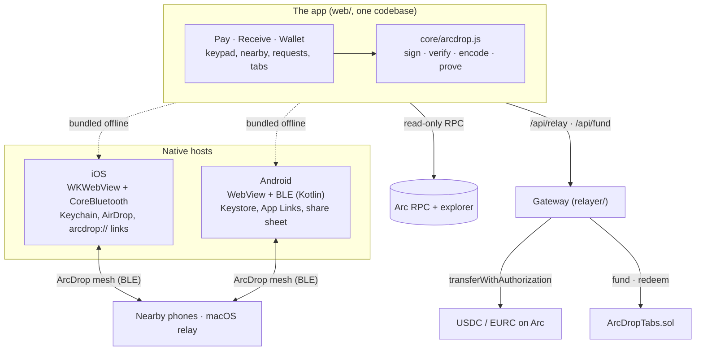
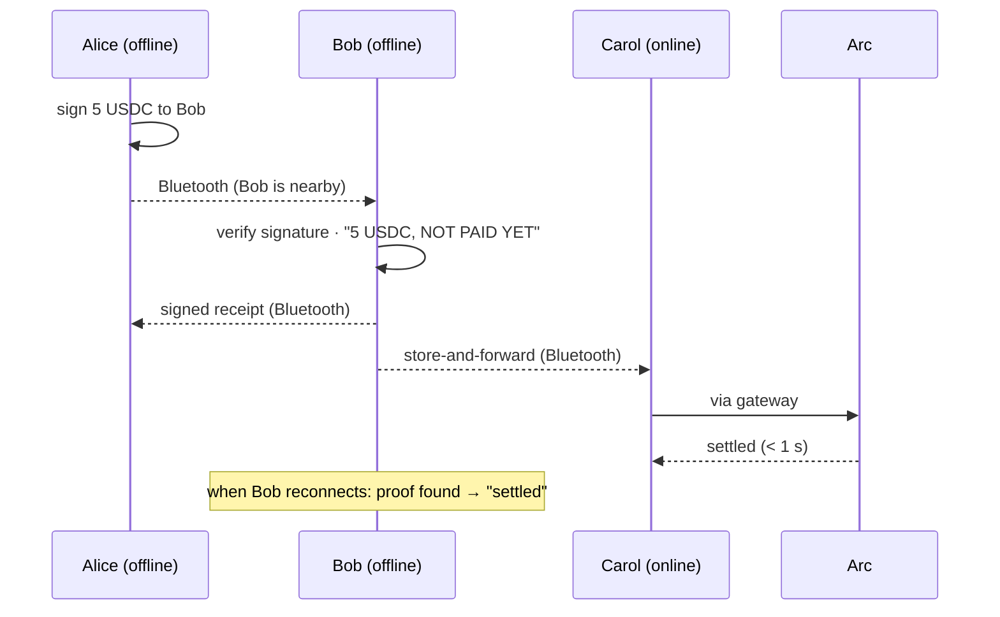
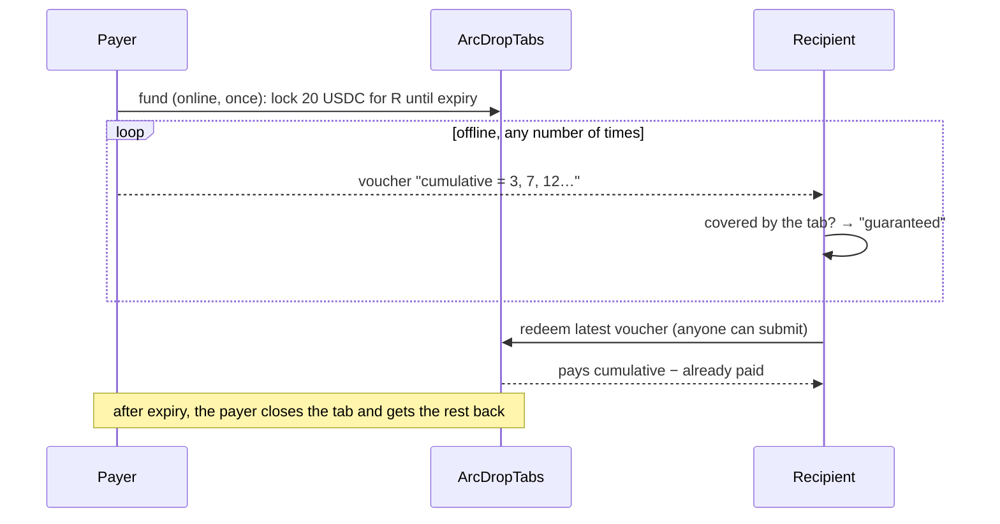

# Architecture



## One app, three shells

The whole product is the web app in [`web/`](../web), built on [`core/`](../core). The iOS and Android apps load a bundled copy (so they work fully offline) and add what a browser can't do: the Bluetooth mesh, a hardware-backed key store, the system share sheet and payment links that open the app. The JS ↔ native bridge is the same on both platforms (`broadcast`, `vouch`, `profile`, `presence`, `share`, `saveKey`…), and only accepts messages from the app's own bundled page.

## Paying offline



## Guaranteed payments (tabs)

A plain offline payment is backed by the payer's balance, which only Arc can check. A **tab** locks funds online for one recipient, so offline payments to them are guaranteed:



- The funding signature's nonce commits to the recipient and the expiry: it can't be replayed for anyone else.
- Before expiry, locked funds can only go to the recipient; closing bumps an epoch so old vouchers die.
- The contract only accepts the chain's real USDC and EURC. Deployed on Arc mainnet at [`0xe95d…1c6a`](https://explorer.arc.io/address/0xe95d1e061f3529029d5cb5269dbffbef10311c6a) (addresses in [`core/tabs.json`](../core/tabs.json)).

## The gateway

[`relayer/server.mjs`](../relayer/server.mjs) (deployed as Vercel functions in [`api/`](../api)) settles payments for recipients who have no gas. For each packet it verifies the signature, refuses dust, self-payments and far-future expiries, checks the payer's balance, simulates the call, then submits it through a serial queue. Abuse limits are layered: a cheap per-IP gate before any RPC call, then per-payer, per-recipient and global quotas once the signature is known, plus an anti ping-pong rule. The relayer key only pays gas.

## Repository map

```
core/          packet formats, signing, verification, proofs (shared everywhere)
web/           the app (PWA), bundled into the native apps by scripts/build.mjs
ios-app/       iOS host (XcodeGen project, Swift)
android-app/   Android host (Gradle, Kotlin)
mesh/          Bluetooth mesh (Swift), macOS relay node, framing tests
relayer/ api/  gateway (Node, Vercel functions)
contracts/     ArcDropTabs.sol + compiled ABI
ios/           optional bitchat integration (patch + relay queue)
scripts/       build, deploy, live end-to-end and attack scripts
test/          offline tests + read-only checks against Arc mainnet
```
