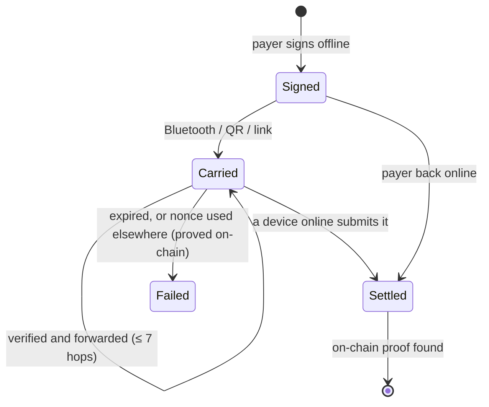

# Protocol

Everything ArcDrop sends is a short text string that works the same in a QR code, a URL fragment, a chat message or a Bluetooth frame. Binary fields are big-endian; the text form is `prefix + base64url(bytes)`, strictly canonical (one payment, one string).

## Payments

| Prefix | Bytes | Layout |
|---|---|---|
| `arcdrop:1:` | 157 | `chainId u32 · from 20 · to 20 · value u64 · validAfter u32 · validBefore u32 · nonce 32 · signature 65` (USDC) |
| `arcdrop:2:` | 158 | `token u8` + the v1 layout (token 1 = EURC) |
| `arcdrop:4:` | 122 | `token u8 · chainId u32 · from 20 · to 20 · epoch u32 · cumulative u64 · signature 65` (tab voucher) |

- **v1 / v2** are EIP-3009 `TransferWithAuthorization` signatures against Circle's USDC / EURC on Arc (FiatToken v2, EIP-712 domain checked against the on-chain `DOMAIN_SEPARATOR`). Anyone can submit them; the money can only go to `to`.
- **v4** is an EIP-712 `TabVoucher(token, from, to, epoch, cumulative)` for [`ArcDropTabs`](../contracts/ArcDropTabs.sol): the running total owed to `to` on that tab.
- Signatures must be canonical (low-s, `v ∈ {27, 28}`, `0 < r < n`): anything the contracts would reject is refused offline too.
- Payments are valid for 7 days (`validBefore`); far-future or postdated ones are refused.

## Proof of payment

"Nonce used" is not proof: a payer could burn their own nonce after handing the packet over. A payment counts as **settled** only when a successful transaction contains this authorization's `AuthorizationUsed` event immediately followed by a `Transfer` of exactly `value` from `from` to `to`. If the transaction can't be found (settled long ago by someone else), the app asks the explorer for candidates and still verifies each one against the chain; until then it shows "unverified", never "paid".

## Receipts

`arcdrop-ack:2:` + `nonce 32 · signature 65`. The recipient signs an EIP-712 `DeliveryNoticeNotPayment` binding the whole payment (never a raw hash supplied by someone else), and it travels back over the mesh. The payer rebuilds the message from the payment it sent: "received by Alice", offline. It is a delivery notice, not a proof of settlement.

## Requests

`arcdrop-req:1:` + `chainId u32 · token u8 · to 20 · value u64 · label (≤ 40 bytes UTF-8)`. Shown as a QR by the receiver; the payer's app pre-fills amount and recipient. Labels are cleaned (no control or bidi characters), amounts must be whole cents.

## Bluetooth mesh

One GATT service `A7C0D509-5E1F-4B8E-9A3B-1D2C3E4F5A60`, one characteristic `…5A61` (write, write-without-response, notify). Every device is both central and peripheral.

**Frame:** `msgId 4 · index u8 · count u8 · hops u8 · chunk`, sized to the link's MTU, reassembled per link (at most 4 partial messages per link, expiring after 10 s).

**Envelope:** `kind u8 · body`, where kind is `1` payment (body = v1/v2/v4 bytes), `2` hello (`address 20 · name ≤ 32 bytes UTF-8`) or `3` receipt.

- Payments and receipts are **store-and-forward**: each node keeps what it has seen and hands it to every device it meets; floods stop after 7 hops; duplicates are dropped by hash.
- In the apps, a payment is stored and forwarded **only after its signature has been checked**.
- Hellos are neighbour-only (never forwarded) and only sent while the Pay screen is open.
- Limits: per-link token buckets, per-kind and per-payer quotas, own payments never evicted, 30-day maximum storage.

## Gateway API

`POST /api/relay` `{ "packet": "arcdrop:…" }` → `{ ok, hash, url, settleMs }` or `{ ok: false, error }`. The gateway verifies the signature, checks the payer's balance, simulates the call, then submits it and pays the gas. `POST /api/fund` opens or tops up a tab from the payer's signature.
